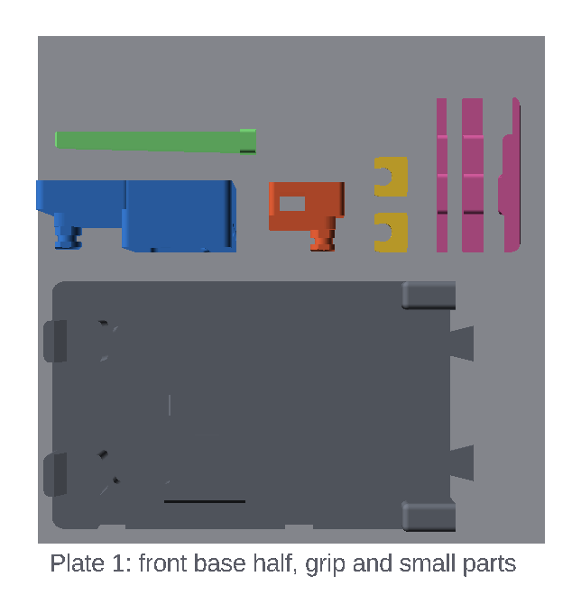
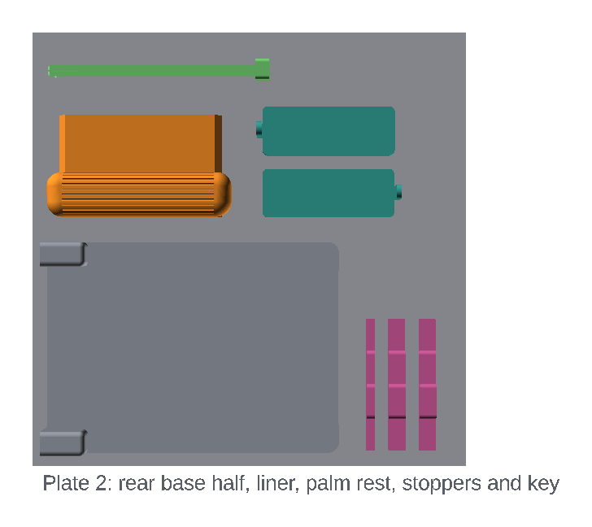

# Printing

## Files

Each [release](https://github.com/crimpdeq/crimpdeq-platform/releases)
includes the STL files and `crimpdeq-platform.3mf`, a Bambu Studio project
with both plates laid out and the settings below applied. The project is set
up for a Bambu Lab A1 with a 0.4 mm nozzle, Generic PETG and the textured PEI
plate. Open it with **File → Open Project**, select your printer, filament
and plate, and print.

Take all the parts from the same release, or they may not fit together.

## Plates

The parts are exported already oriented for printing, so don't rotate them.
The grip and the anchor block lie on their sides, so the pull on their lugs
runs along the layers instead of across them.
If you lay out the plates yourself, keep the parts at least 15 mm apart.

## Print settings

| Setting | Value |
|---|---|
| Layer height | 0.2 mm |
| Walls | 6 |
| Top/bottom layers | 6 |
| Infill | 20% |
| Supports | **Off**, except on `grip`, `anchor` and `rest` |
| Brim | Outer brim only, 5 mm |

Per-object overrides:

| Object | Override |
|---|---|
| `grip`, `anchor` | 100% infill; normal supports, on the build plate only, not under bridges |
| `anchor_key`, `clips`, `key`, `liner` | 100% infill |
| `rest` | 50% infill; normal supports, on the build plate only, not under bridges |
| `base_front`, `base_rear` | 4 walls, 4 top and 4 bottom layers, 15% adaptive cubic infill |

Adaptive cubic infill keeps its density next to the walls and the top and
bottom layers and grows sparser deep inside the base halves, where it carries
no load. In a slicer without it, use 15% of another infill pattern.

The project also prints these zones differently, using height range
modifiers. The lightly loaded ones print sparser to save filament, and the
palm rest's bolster prints with fuzzy skin, a rough, sandpaper-like outer wall
that keeps the palm from sliding:

| Object | Range | Override |
|---|---|---|
| `base_front` | 40.1–56.6 mm | 10% infill |
| `rest` | 6–18 mm | 15% infill; fuzzy skin on the outer walls (0.3 mm thick, 0.8 mm point distance) |

In another slicer, apply fuzzy skin only to that range of the rest: on the
heel plate's flanks below it, it would jam the rest in its channel.

Supports go only from the build plate: under the tongue and the lug of the
grip and the anchor block, and under the palm rest's wings. Keep them off
everywhere else, including the grip's pocket and the rest's key groove:
they would scar the faces that the fingers, the palm rest and the keys bear
on. The lugs are cut flat where their supports touch, so the scars stay
clear of the load-cell eyes.

After printing, remove the brims and the supports, and trim any flared first
layer on the base halves' joint faces and on the palm rest's sole. Each lug
must slide into a load-cell eye without force. Sand the
wings' undersides smooth so they slide on the deck.
